# Live browser screenshots

Latest: [November 12 reference design iteration](reference-v2/README.md) · [live preview](reference-v2/index.html). The screenshots below document the earlier drawer implementation.

Captured from the running Home UI in Safari on November 12, 2026. These are browser screenshots, not concept art. The preview bundles the actual `src/native.js` entry point and production styles. Its native service and notebook boundaries supply **synthetic snapshots**; there is no microphone, vault, or remote write connection. The grocery success message and saved items demonstrate rendering only, not a completed real save. Calculator values and graphs are computed by the real local parser.

## Reproduce

Run `node scripts/build-assistant-preview.mjs` after installing the repository dependencies. Open the generated `index.html` path printed by the script in a browser. The script writes only to a temporary output directory by default; an optional first argument selects another directory. Choose a scenario using the preview toolbar. Use the drawer handle to expand, scroll its content to the calculator, and type an expression. The portrait checkbox switches the app frame from 1024 × 700 to 390 × 700 CSS pixels.

The harness intentionally refuses unsupported native operations. It does not simulate writable persistence or replace the production voice state implementation. Its scenario selector injects service snapshots into the existing poll and uses the actual character/outfit settings controls. The production bundle is embedded in an async script so the preview can run directly from a local file.

## Luna

Final synthetic recognition and response, over the existing Home:

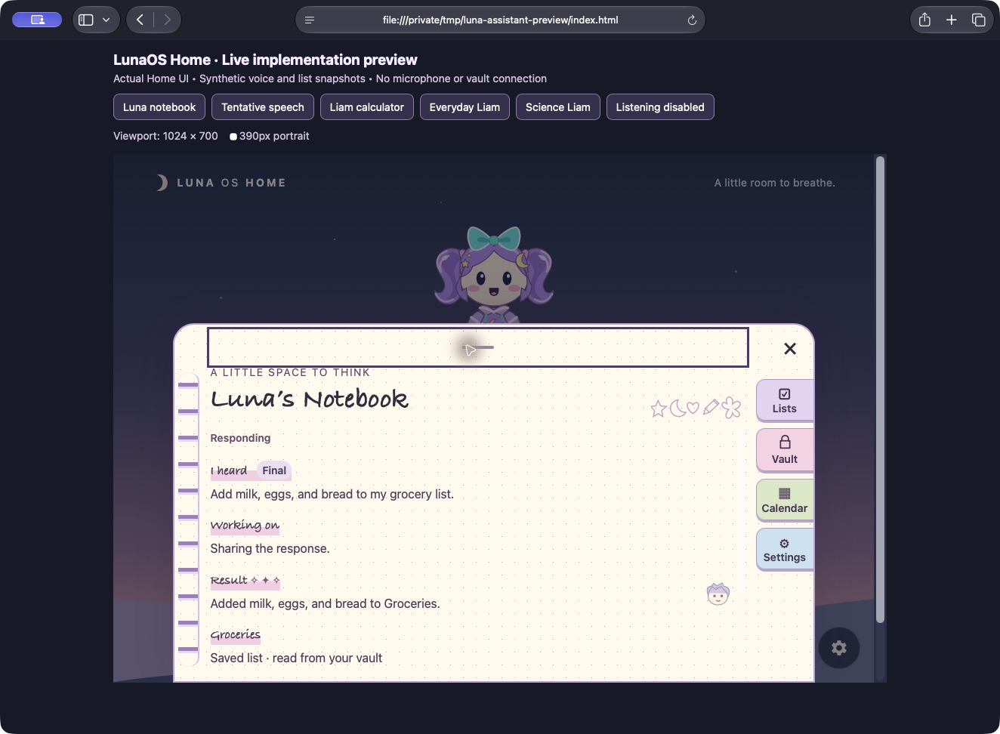

Expanded notebook with synthetic saved-list contents:

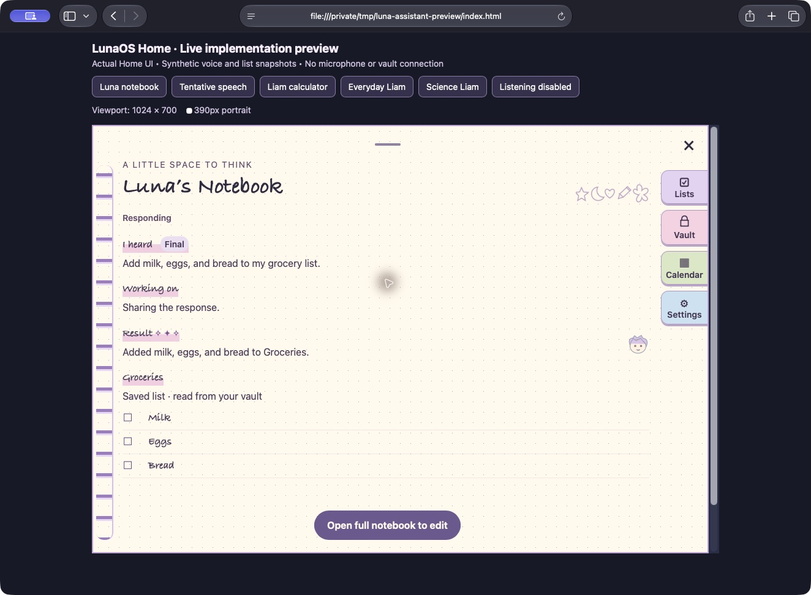

Tentative recognition with no result asserted:

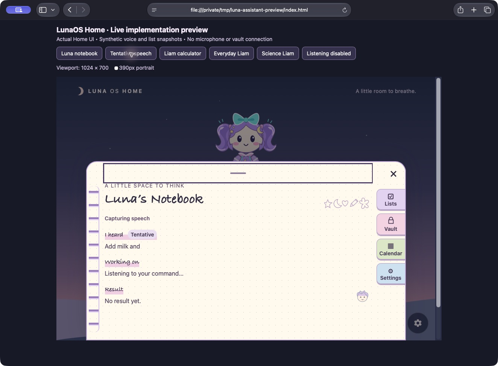

Portrait layout with all four navigation tabs visible:

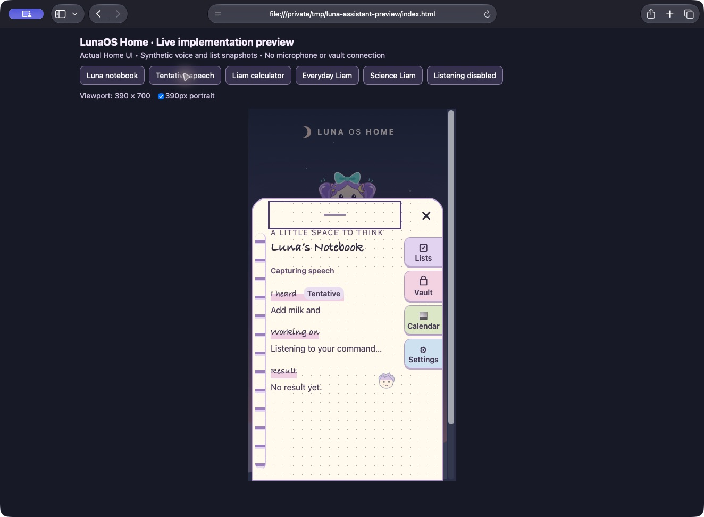

## Liam TX-18

Calculator drawer over the existing Home:

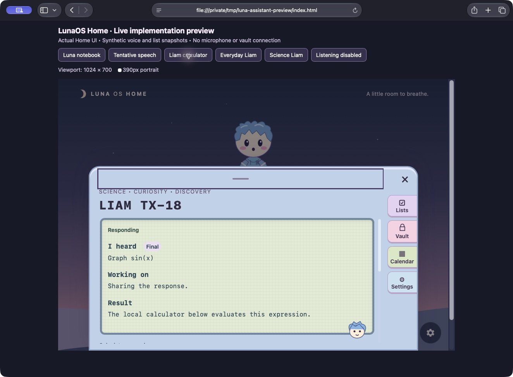

Computed `sin(x)` graph; expanded drawer scrolled to its calculator controls:

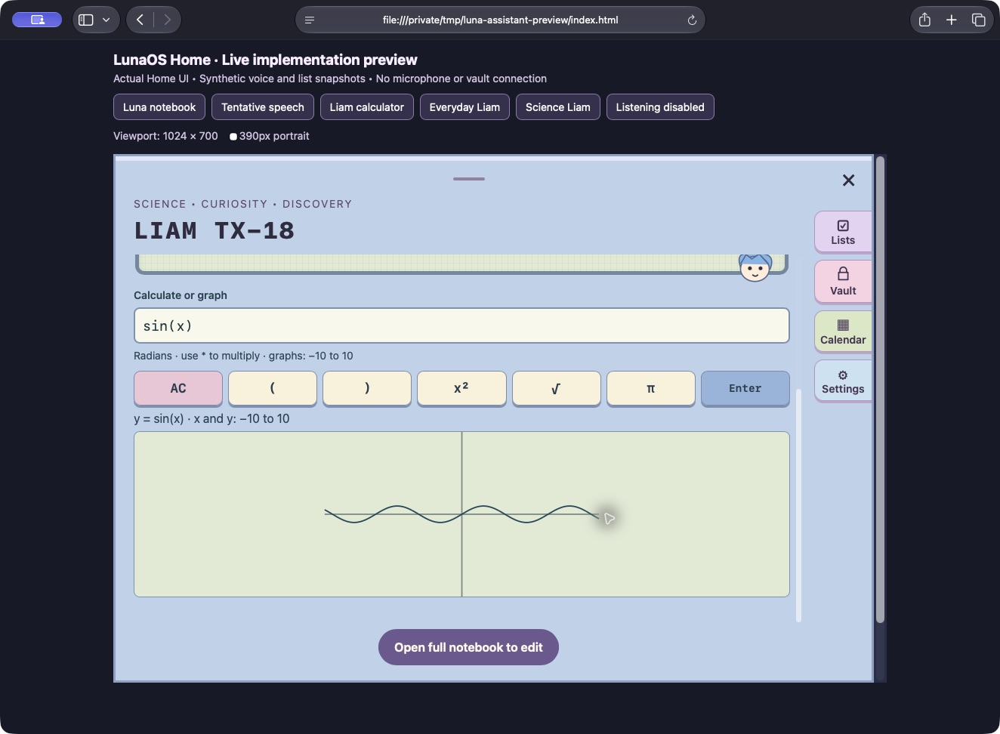

Manually entered `sqrt(9) + 2^3`, followed by Enter, returned **11**:

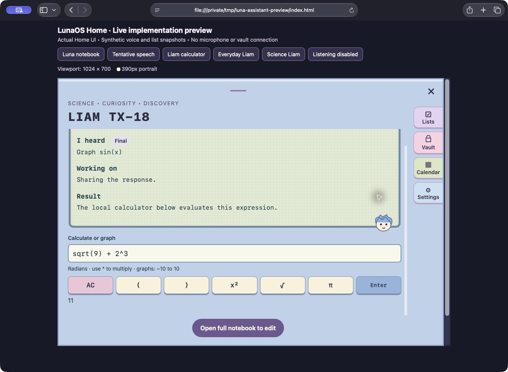

Portrait graph and wrapped physical-style controls:

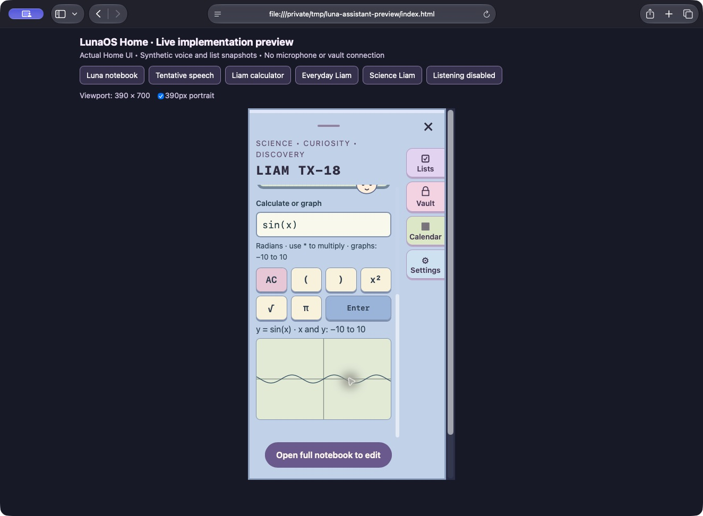

## Wardrobe and listening availability

Listening enabled and idle, everyday outfit without a sleep mask:

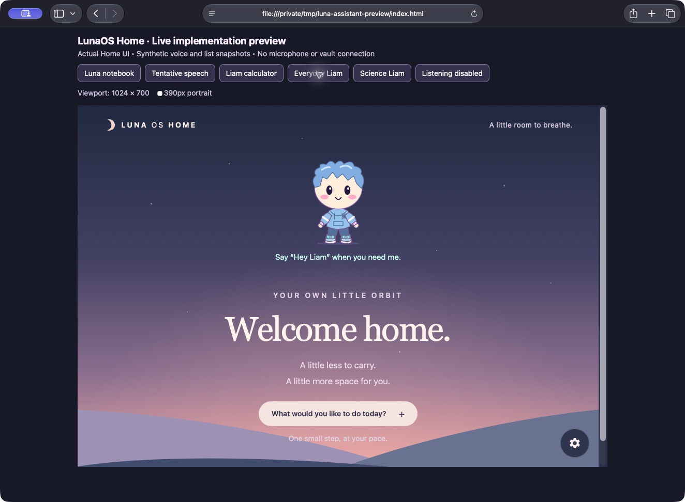

Science outfit selected through the existing setting, with the same face and proportions:

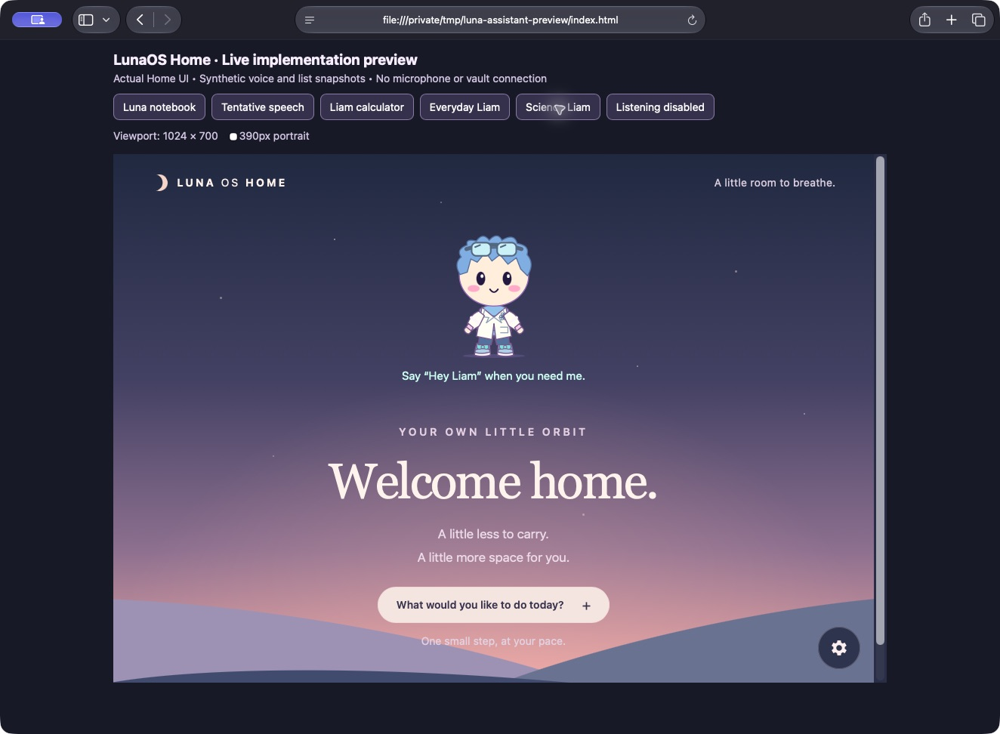

Explicit listening-disabled snapshot, showing the sleep mask:

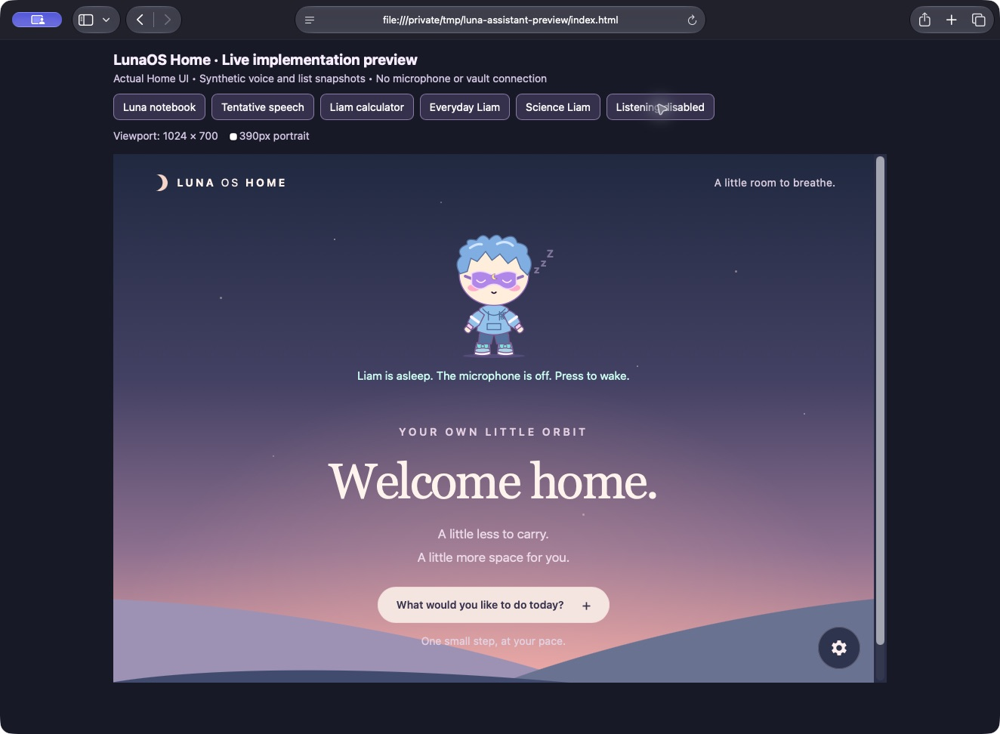

## Scope of verification

Observed live in Safari: both drawer themes, expansion, final/tentative labels, synthetic list/result rendering, computed graph, manual calculation, both outfits, disabled sleep mask versus enabled idle, and the two frame sizes above. Visual inspection exposed and fixed inherited low-contrast labels, scrollbar-related drawer clipping, and narrow navigation label space. The disabled caption now works for either character.

These captures do not verify real wake-word audio, microphone capture, vault writes, native playback/timers, reduced-motion behavior, or the physical target device. The device checklist remains in [the architecture notes](../architecture/assistant-drawers.md).
